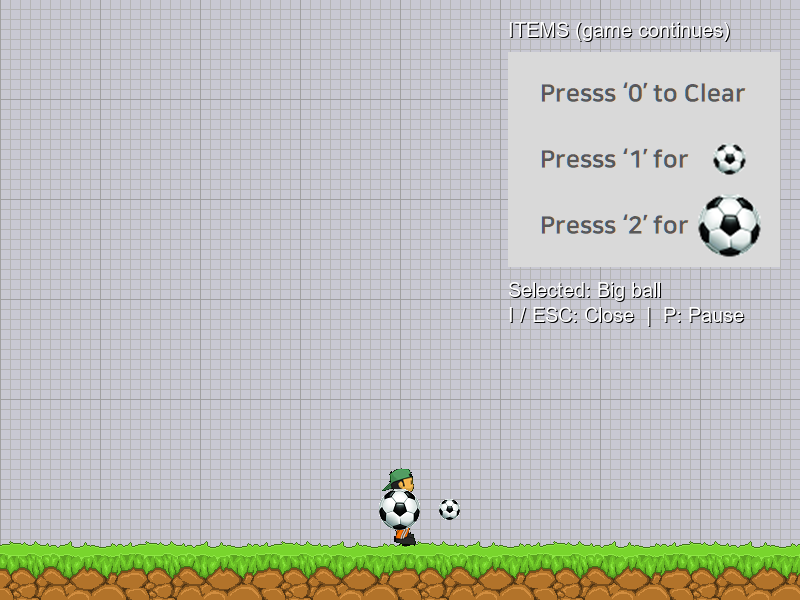
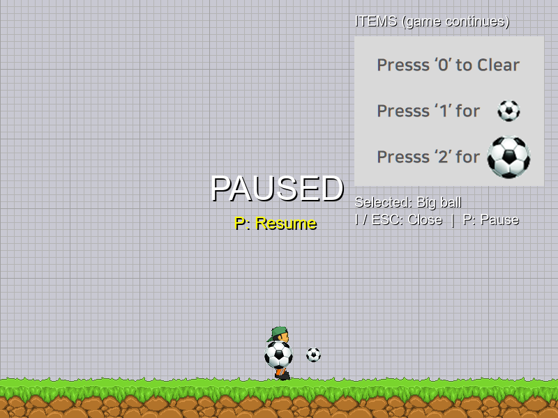

# Drill-13

로고, 타이틀, 플레이, 정지 모드와 **플레이가 계속되는 아이템 선택 창**을 구현한 2D 게임 프레임워크 과제입니다.

## 실행

Windows의 Python 3 환경에서 실행합니다. Python 3.14에서 검증했습니다.

```powershell
git clone https://github.com/Rito0114/Drill-13.git
cd Drill-13
python -m pip install -r requirements.txt
python main.py
```

코드와 PNG 이미지는 같은 폴더에 있어야 합니다. 안내 문구에는 Windows 기본 Arial 글꼴을 사용합니다.

## 조작

| 화면 | 키 | 동작 |
| --- | --- | --- |
| 로고 | 자동 | 2초 후 타이틀로 전환 |
| 타이틀 | SPACE / ESC | 플레이 시작 / 종료 |
| 플레이 | ← / → | 이동 |
| 플레이·아이템 창 | SPACE | 선택한 공 발사(자는 중이면 먼저 깨움) |
| 플레이 | I | 아이템 창 열기 |
| 아이템 창 | 0 / 1 / 2 | 선택 해제 / 21×21 작은 공 / 41×41 큰 공 |
| 아이템 창 | I / ESC | 아이템 창 닫기 |
| 플레이·아이템 창 | P | 일시 정지 |
| 정지 | P / ESC | 이전 화면으로 재개 / 타이틀로 복귀 |
| 플레이 | ESC | 타이틀로 복귀 |
| 모든 화면 | 창 닫기 | 종료 |

아이템 창을 열어도 캐릭터와 공의 움직임이 계속됩니다. 숫자 선택 후 창은 유지되며 현재 선택이 표시됩니다. 기본 상태는 선택 없음입니다. 0은 장착을 해제하며, 이미 발사한 공은 그대로 움직입니다. 정지 시에는 `PAUSED` 안내가 표시되고 게임 업데이트와 유휴 타이머가 멈춥니다.

## 검증

```powershell
python verify_modes.py
```

실제 pico2d 캔버스에서 모드 전환, 아이템 창 중 이동과 공 업데이트, 0/1/2 선택, 발사 이미지 분리, 정지/재개, 반복 진입 시 객체 정리를 확인합니다.

요구사항과 화면 흐름은 [PRD.md](PRD.md)에 기록했습니다. 기존 대화에서 개발한 기능은 이번 저장소에 기능별 커밋으로 정리했고, 신규 아이템 기능은 구현·검증 단계별로 커밋했습니다.

## 실행 화면

아이템 창을 연 플레이 화면:



P 키로 정지한 화면:


